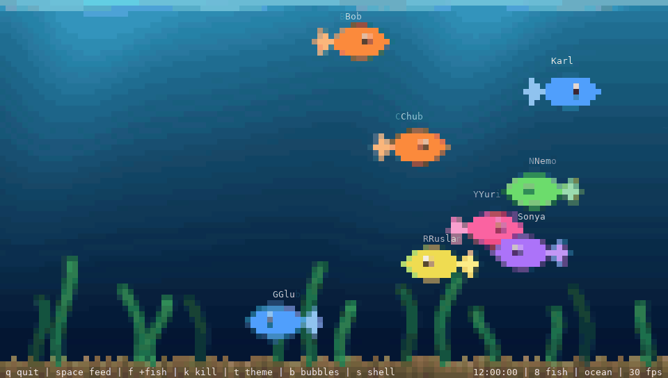

# fish.c

**A tiny animated aquarium written in C.**

<p align="center">
  
</p>

`fish.c` is a terminal-based aquarium simulation built with C. It brings a small underwater world to your terminal, featuring animated fish, food particles, and a custom rendering system.

No GUI frameworks, no heavyweight dependencies, no unnecessary abstraction. Just C, a terminal, and a little aquatic life.

---

## Features

- **Animated aquarium** - fish move around the aquarium in real time.
- **Fish behavior** - autonomous movement and interaction with the environment.
- **Feeding system** - fish can detect, pursue, and consume food particles.
- **Fish management** - add new fish to the aquarium or remove existing ones.
- **Custom rendering engine** - framebuffer-based rendering with alpha blending and layered compositing.
- **Subpixel rendering** - improved visual resolution using terminal character cells.
- **Differential rendering** - redraws only changed portions of the frame to reduce unnecessary terminal output.
- **Color palettes** - multiple visual themes for different aquarium aesthetics. See [assets](assets) for screenshots.
- **Kitty graphics (optional)** - in a local terminal that speaks the kitty graphics protocol (kitty, Ghostty, ...) the water is sent as an image through shared memory and only the text stays text: the terminal has much less to parse. Detected automatically (`-g auto`); everywhere else - ssh, tmux, other terminals - the half-block renderer is used as before. The image is scaled by fish itself to exactly the window's pixels (terminals stretch smaller images with a smooth filter, which blurs pixel art); if your terminal does not report its cell size, tell fish with `FISH_CELL_SIZE=10x21 ./build/fish`. When the terminal agrees to read plain files from your runtime directory (it is asked at start-up), the frames are rewritten **in place** in a ring of three files and only the pixels that changed are touched, which is several times cheaper than a new shared-memory object per frame; otherwise shared memory is used.
- **Lightweight** - a small native executable with minimal runtime dependencies.
- **Integrated terminal** - launch an interactive `$SHELL` session inside a translucent terminal panel rendered directly over the aquarium. Supports pseudo-terminal communication, ANSI escape sequences, scrollback, and background aquarium animation.

## Requirements

- Linux or another compatible POSIX environment.
- A terminal emulator with ANSI escape sequence support.
- C compiler with GNU C11 support.
- GNU Make.
- Standard C library and `libm`.

## Building

Clone the repository:
```bash
git clone https://github.com/3xxx0rc1st/fish.c
cd fish.c
```

Build the project:

```bash
make
```

Run the aquarium:

```bash
make run
```

Alternatively, execute the binary directly:

```bash
./build/fish
```

## Make targets

| Target | Description |
|---|---|
| `make` | Build the executable |
| `make all` | Build the executable |
| `make run` | Build and launch the aquarium |
| `make debug` | Build with AddressSanitizer and UndefinedBehaviorSanitizer |
| `make install` | Install the executable |
| `make uninstall` | Remove the installed executable |
| `make clean` | Remove build artifacts |
| `make help` | Display available targets |

### Build configuration

The Makefile supports several configurable variables:

| Variable | Default | Description |
|---|---|---|
| `CC` | `gcc` | C compiler |
| `CFLAGS` | `-O2 -pipe` | Compiler flags |
| `LDFLAGS` | — | Linker flags |
| `LDLIBS` | `-lm` | Additional libraries |
| `BUILD_DIR` | `build` | Build directory |
| `PREFIX` | `/usr/local` | Installation prefix |
| `DESTDIR` | — | Staging directory |
| `ARGS` | — | Runtime arguments |

For example, to build with a custom optimization configuration:

```bash
make CFLAGS="-O3 -march=native -pipe"
```

To install into a staging directory:

```bash
make install DESTDIR=/tmp/fish-root
```

## Controls

### Keyboard

| Key | Action |
|---|---|
| `Space` | Drop food into the aquarium |
| `F` / `f` | Add a new fish |
| `K` / `k` | Remove a fish |
| `T` / `t` | Cycle through color palettes |
| `B` / `b` | Release bubbles |
| `S` / `s` | Show or hide the integrated terminal |
| `F12` / `Ctrl-]` | Hide the terminal panel |
| `Shift-PgUp` / `Shift-PgDn` | Scroll terminal history |
| `Q` / `q` | Quit the aquarium |

### Mouse

| Input | Action |
|---|---|
| Left click | Drop food at the cursor position |
| Right click | Remove a fish at the cursor position |

## Integrated terminal

`fish.c` features a built-in terminal emulator that allows users to interact with their system shell without leaving the aquarium.

Press `S` / `s` to open the terminal panel. On its first activation, the application spawns the user's `$SHELL` inside a pseudo-terminal (PTY). Subsequent activations show or hide the existing session without terminating it.

Unlike a conventional shell launcher, the integrated terminal does not suspend the aquarium simulation. Fish continue swimming, environmental animations remain active, and the terminal is rendered as a translucent overlay above the underwater scene.

### Terminal capabilities

The built-in terminal emulator implements a subset of the xterm terminal specification, including:

- Pseudo-terminal (PTY) communication.
- ANSI escape sequence processing.
- 16/256-color terminal rendering.
- Cursor positioning and visibility.
- Scrolling regions.
- Alternate screen buffer support.
- Scrollback history.
- Mouse wheel and keyboard-based history navigation.
- Terminal resizing.
- Transparent panel compositing over the aquarium.

### Interaction

- `S` / `s` - Show or hide the terminal panel.
- `F12` / `Ctrl-]` - Hide the terminal panel.
- `Shift-PgUp` / `Shift-PgDn` - Scroll through terminal history.
- Mouse wheel - Navigate terminal history when the panel is visible.

The shell process remains alive while the terminal panel is hidden. It terminates when the shell exits or the aquarium shuts down.

The implementation relies on POSIX pseudo-terminals and process management, with no external terminal emulation libraries or additional runtime dependencies.

## Under the hood

The project is designed around a custom terminal rendering pipeline rather than relying on a third-party graphics library.

Its rendering architecture includes:

- Framebuffer-based drawing.
- Layer compositing.
- Alpha blending.
- Subpixel-level rendering.
- Frame differencing to minimize terminal updates.
- Time-based animation and frame pacing.
- PTY-based process management.
- Embedded terminal emulator.
- Layered terminal compositing.
- Independent shell lifecycle.

The goal is to keep rendering efficient while maintaining smooth animation and a visually interesting aquarium.

## Dependencies

The project deliberately keeps its runtime dependency footprint small.


The resulting executable links against:

- `libc`
- `libm`

The integrated terminal uses native POSIX interfaces for pseudo-terminal creation, process management, and terminal I/O.

No external terminal emulation libraries are required.

## License

See [LICENSE](LICENSE) for licensing information.

---

**Made with C, curiosity, and an unreasonable amount of attention to terminal rendering.**
