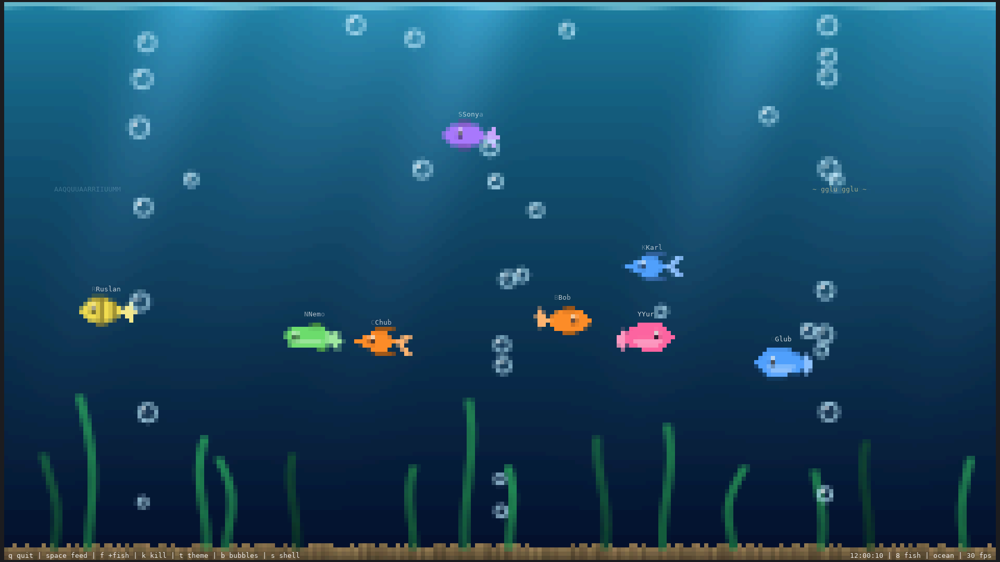

# fish.c

**A tiny animated aquarium written in C.**

<p align="center">
  
</p>

`fish.c` is a terminal-based aquarium simulation built with C. It brings a small underwater world to your terminal, featuring animated fish, food particles, and a custom rendering system.

No GUI frameworks, no heavyweight dependencies, no unnecessary abstraction. Just C, a terminal, and a little aquatic life.

---

## Features

- **Animated aquarium** - fish move around the aquarium in real time.
- **Fish behavior** - autonomous movement and interaction with the environment.
- **Feeding system** - fish can detect, pursue, and consume food particles.
- **Fish management** - add new fish to the aquarium or remove existing ones.
- **Custom rendering engine** - framebuffer-based rendering with alpha blending and layered compositing.
- **Subpixel rendering** - improved visual resolution using terminal character cells.
- **Differential rendering** - redraws only changed portions of the frame to reduce unnecessary terminal output.
- **Color palettes** - multiple visual themes for different aquarium aesthetics. See [assets](assets) for screenshots.
- **Lightweight** - a small native executable with minimal runtime dependencies.

## Requirements

- Linux or another compatible POSIX environment.
- A terminal emulator with ANSI escape sequence support.
- C compiler with GNU C11 support.
- GNU Make.
- Standard C library and `libm`.

## Building

Clone the repository:

```bash
git clone https://github.com/3xxx0rc1st/fish.c
cd fish.c
```

Build the project:

```bash
make
```

Run the aquarium:

```bash
make run
```

Alternatively, execute the binary directly:

```bash
./build/fish
```

## Make targets

| Target | Description |
|---|---|
| `make` | Build the executable |
| `make all` | Build the executable |
| `make run` | Build and launch the aquarium |
| `make debug` | Build with AddressSanitizer and UndefinedBehaviorSanitizer |
| `make install` | Install the executable |
| `make uninstall` | Remove the installed executable |
| `make clean` | Remove build artifacts |
| `make help` | Display available targets |

### Build configuration

The Makefile supports several configurable variables:

| Variable | Default | Description |
|---|---|---|
| `CC` | `gcc` | C compiler |
| `CFLAGS` | `-O2 -pipe` | Compiler flags |
| `LDFLAGS` | — | Linker flags |
| `LDLIBS` | `-lm` | Additional libraries |
| `BUILD_DIR` | `build` | Build directory |
| `PREFIX` | `/usr/local` | Installation prefix |
| `DESTDIR` | — | Staging directory |
| `ARGS` | — | Runtime arguments |

For example, to build with a custom optimization configuration:

```bash
make CFLAGS="-O3 -march=native -pipe"
```

To install into a staging directory:

```bash
make install DESTDIR=/tmp/fish-root
```

## Controls

### Keyboard

| Key | Action |
|---|---|
| `Space` | Drop food into the aquarium |
| `F` / `f` | Add a new fish |
| `K` / `k` | Remove a fish |
| `T` / `t` | Cycle through color palettes |
| `B` / `b` | Release bubbles |
| `Q` / `q` | Quit the aquarium |

### Mouse

| Input | Action |
|---|---|
| Left click | Drop food at the cursor position |
| Right click | Remove a fish at the cursor position |

## Under the hood

The project is designed around a custom terminal rendering pipeline rather than relying on a third-party graphics library.

Its rendering architecture includes:

- Framebuffer-based drawing.
- Layer compositing.
- Alpha blending.
- Subpixel-level rendering.
- Frame differencing to minimize terminal updates.
- Time-based animation and frame pacing.

The goal is to keep rendering efficient while maintaining smooth animation and a visually interesting aquarium.

## Dependencies

The project deliberately keeps its runtime dependency footprint small.

The resulting executable links against:

- `libc`
- `libm`

No external graphics libraries or GUI toolkits are required.

## License

See [LICENSE](LICENSE) for licensing information.

---

**Made with C, curiosity, and an unreasonable amount of attention to terminal rendering.**
